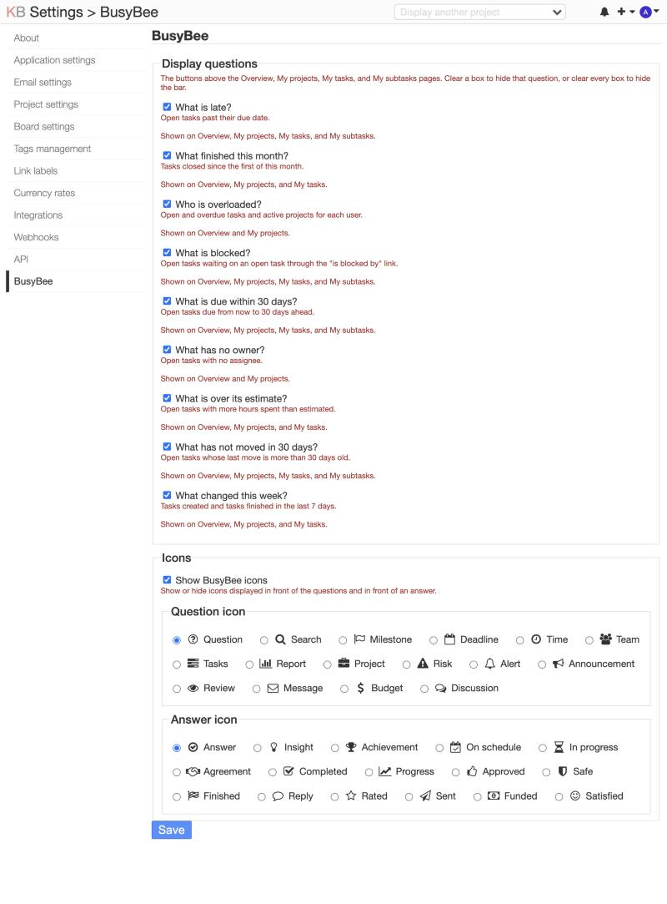

# BusyBee

*BusyBee* is a [Kanboard](https://kanboard.org) plugin that adds one-click questions about your projects, tasks, and subtasks, such as "What's being worked on?", "What is late?", "What is blocked?" to the top of Kanboard's dashboard pages.

Clients, stakeholders, and executives often ask the same questions every week and shouldn't have to build a filter to get an answer. With *BusyBee*, every question is a button (with a current count), and clicking it opens the answer.

If [SortaFolders](https://github.com/christefano/SortaFolders), a plugin that sorts projects into folders, is installed, the same question buttons also show at the top of its *My folders* page.

## Screenshot

*Settings -> BusyBee* turns questions on and off and picks the icons shown next to questions and answers.

## Quick start

1. Copy the `BusyBee` folder into Kanboard's `plugins/` directory.
2. Reload PHP-FPM if OPcache is on and a changed file doesn't show up, since OPcache can serve the old copy for a few minutes.
3. Open the dashboard. BusyBee's questions show at the top of the Overview page.
4. Optionally turn specific questions on and off and choose the icons shown next to questions and answers under *Settings -> BusyBee*.

[INSTALL.md](INSTALL.md) covers the requirements, removal, updating, and conflicts.

## The questions

Each button shows a live count of possible answers to the question inside the button. A question button that has a "0" won't have any answers.

| Question | What it measures |
|---|---|
| What is late? | Open tasks past their due date |
| What finished this month? | Tasks closed since the first of this month |
| Who is overloaded? | Users with an open task. The answer lists each user's open tasks, overdue tasks, and active projects, most overdue first, with unassigned work last |
| What is blocked? | Open tasks waiting on an open task through the "is blocked by" link |
| What is due within 30 days? | Open tasks due from now to 30 days ahead |
| What has no owner? | Open tasks with no assignee |
| What is over its estimate? | Open tasks with more hours spent than estimated |
| What has not moved in 30 days? | Open tasks whose last move is more than 30 days old (the creation date counts when a task never moved) |
| What changed this week? | Tasks created plus tasks closed in the last 7 days. A task that was both shows twice |
| What's being worked on? | Tasks changed in the last 30 days with newest first. Changes include an edit, a move, a new comment, a subtask, an attached file, or closing the task |

## Where they show

| Page | Questions | Tasks counted |
|---|---|---|
| *Overview* | All | Every task in your active projects |
| *My projects* | All | Every task in your active projects |
| *My tasks* | Late, Finished this month, Blocked, Due within 30 days, Over its estimate, Not moved in 30 days, Changed this week, and Being worked on | Tasks you own or that you have a subtask on |
| *My subtasks* | Late, Blocked, Due within 30 days, Not moved in 30 days, and Being worked on | Tasks with an open subtask assigned to you |
| *My folders* ([SortaFolders](https://github.com/christefano/SortaFolders)-only) | All | Every task in the projects the page lists. One folder narrows it to the projects in that folder and its subfolders |

*My tasks* leaves out "Who is overloaded?" and "What has no owner?" since *My tasks* only lists that user's tasks. *My subtasks* keeps only the questions that read the parent task's dates and links.

## How "What's being worked on?" words a change

The Change column names the newest change to the task. These are all the wordings:

| Change | Wording |
|---|---|
| Task created | Created |
| Task edited | Edited |
| Task closed | Closed |
| Task reopened | Reopened |
| Moved to another column | Moved to another column |
| Moved up or down within its column | Moved within its column |
| Moved to another swimlane | Moved to another swimlane |
| Moved to another project | Moved to another project |
| Owner changed | Owner changed |
| Someone mentioned in the task | Someone was mentioned |
| Subtask added, changed, or deleted | New subtask, Subtask updated, Subtask deleted |
| Comment added, edited, or deleted | New comment, Comment edited, Comment deleted |
| Someone mentioned in a comment | Someone was mentioned in a comment |
| File attached or removed | File attached, File removed |
| Link to another task added, changed, or removed | Link added or changed, Link removed |
| Anything else Kanboard records | Updated |

A task changed in a way that left no activity record, such as through a script, reads Moved, Edited, or Created from the task's own dates.

## What an answer shows

A one-line answer is shown first, such as "3 tasks in 2 projects are late." (with [SortaFolders](https://github.com/christefano/SortaFolders) installed it counts folders, such as "3 tasks in 2 folders are late."). Tables show each task, its owner (or its due date for "What has no owner?"), a column that fits the question, and the project name. The table has 25 rows to a page. When there are more, a pager like the one under Kanboard's own lists appears under it, with "Showing 1-25 of 36" and Previous and Next links (the page is `ask_page` in the address, since `page` belongs to the list under the bar). A question with nothing to list answers in one line, such as "Nothing is due within 30 days."

"What is blocked?" lists each waiting task with its blocker and the blocker's owner. "Who is overloaded?" lists users with a task tracking bar for open and overdue tasks.

Click an open question again to close it.

## Settings

Settings are in *Settings -> BusyBee*, which only an admin can open, and "Display questions" has a checkbox for each question, a one-line description, and a "Shown on" line that lists the pages it appears on. Uncheck a question to hide that question everywhere, or uncheck every question to hide the BusyBee questions bar completely.

"Show BusyBee icons" is on by default. Uncheck it to hide the icon in front of the questions and the icon in front of an answer.

The "Question icon" is shown in front of the row of buttons, and the "Answer icon" is shown in front of an open answer. The defaults are "Question" and "Answer", but match your question and answer icons however you'd like. For example, I like to pair "Report" with "Progress" and "Discussion" with "Reply" on my Kanboard sites.

A saved question setting is stored as `busybee_ask_<question>` and the icon settings as `busybee_icons`, `busybee_question_icon`, and `busybee_answer_icon`. The question settings and `busybee_icons` hold `1` for on and `0` for off, and the two icon settings hold the icon's name, such as `bar-chart`. Until you save the page, BusyBee reads the `sortafolders_ask_<question>` setting, so a question you turned off remains off. BusyBee doesn't delete the old setting.

The page URL is `?controller=SettingsController&action=index&plugin=BusyBee`. The pretty URL `/settings/busybee` is registered, too.

## Limitations

- Tested on SQLite with Kanboard 1.2.54, and installed on a site that runs MariaDB. Oracle MySQL is untested.
- Counts and answers use only your active projects. The one exception is the blocker in "What is blocked?", which shows its title, owner, and path when you can open its project, even a closed one (a closed project is marked "(closed project)"). A task blocked by a task in a project you can't open, or in a project SortaFolders hides from you, shows the answer as "A task in a project you cannot see", with no title, owner, or path.
- "What is blocked?" finds the link by its label, "is blocked by". If an admin renames that link, the count is 0 and nothing warns about it.
- BusyBee uses the Font Awesome icons already in Kanboard (Font Awesome 4.7). Font Awesome has "Bee" and "Honey pot" in the Pro set only, so unfortunately they aren't supported. I didn't want to use custom SVG icons, so here we are.

## Other plugins

BusyBee works with several other plugins by the same author:

- [NotifyMe](https://github.com/christefano/NotifyMe) emails you about your own actions in a project, adds a vacation mode, notifies users of failed login attempts and gives admins control of how many notifications are shown in the Notifications menu. Its email footer uses NotKanboard's name when both are installed.
- [NotKanboard](https://github.com/christefano/NotKanboard) helps whitelabel Kanboard and replaces "Kanboard" in page titles, outgoing emails, and a few other places with your own product name.
- [SortaFolders](https://github.com/christefano/SortaFolders) sorts projects into folders. Kanboard doesn't let you group projects together or classify a project by putting it in another project, so *SortaFolders* adds nestable folders up to 5 levels deep and a dedicated *My folders* page on your dashboard that lists your projects by folder.
- [TagAlong](https://github.com/christefano/TagAlong) supercharges Kanboard email support by filtering autoreplies, email signatures, and quoted text from incoming mail, points Reply-To to the reply-by-email address and adds a reply token to email subjects, so replies become task comments through [Mailmagik](https://github.com/creecros/Mailmagik/).

## Compatibility

- Needs Kanboard 1.2.54 or later, and has been tested on 1.2.54 only.
- No tables and no Kanboard core files are edited.
- Core's Overview, My projects, My tasks, and My subtasks pages share one layout with no hook above the content. Without SortaFolders, BusyBee overrides that layout (`dashboard/layout`) with a copy of core's that adds one line. It does that in `onStartup()`, after every plugin has loaded, so it knows whether SortaFolders is on. When SortaFolders is on, BusyBee leaves the layout alone since SortaFolders overrides the same one, and it fills the two hooks SortaFolders renders instead: `template:sortafolders:folder:before-tabs` and `template:sortafolders:dashboard:before-tabs`.
- It also uses the `template:config:sidebar` and `template:layout:css` hooks.
- It adds the `busyBee` helper, the `busyBeeAnswerModel` service, the `/settings/busybee` route, and the `busybee_ask_` and the three icon settings.

## License

GNU General Public License v2. See LICENSE for details.
